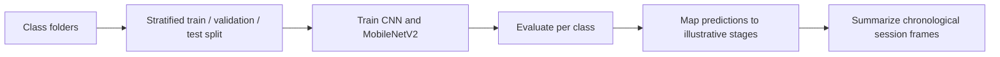

# Driver Fatigue Detection

An educational computer vision project that classifies eye and mouth states from facial images, compares two image classifiers, and demonstrates how predictions can be summarized across a time-ordered session.

> **Prototype only:** This project is for learning and experimentation. It has not been validated for driving or medical use and must not be used to decide whether anyone is safe to drive.

## Project at a glance

| | |
|---|---|
| **Task** | Four-class facial image classification |
| **Labels** | `Closed`, `Open`, `no_yawn`, `yawn` |
| **Models** | Custom CNN and frozen ImageNet MobileNetV2 |
| **Framework** | TensorFlow / Keras |
| **Notebook** | [Open the end-to-end notebook](Driver_Fatigue_Detection.ipynb) |

The notebook also derives separate eye-state and mouth-state tasks, evaluates held-out images, maps image predictions to three illustrative fatigue stages, and includes a simple brightness stress check.

## Workflow



## Repository contents

| File | Purpose |
|---|---|
| [`Driver_Fatigue_Detection.ipynb`](Driver_Fatigue_Detection.ipynb) | Data inspection, preprocessing, model training, evaluation, progression demo, and stress check |
| [`requirements.txt`](requirements.txt) | Python package requirements |

Training outputs are written to an `artifacts/` folder when the notebook is run. They are generated locally and are not included in this repository.

## Dataset

The supplied archive used for this project contains **2,900 JPG images** in four class folders under `train/`:

| Folder | Meaning |
|---|---|
| `Closed` | Eyes closed |
| `Open` | Eyes open |
| `no_yawn` | No yawn |
| `yawn` | Yawn |

The archive does not include separate validation or test folders, a dataset citation or license, or subject/session identifiers. The notebook therefore creates a reproducible, stratified **70% / 15% / 15% image-level split**. Images of the same person or recording could appear across splits; use a person- or session-level split if those identifiers become available. Confirm the dataset source and reuse terms before redistribution or publication.

The dataset archive is not stored in this repository. Place the supplied ZIP beside the notebook, or change `ZIP_PATH` in the setup cell. The notebook checks for `archive (2) (1)(1).zip` and `archive (2) (1).zip` by default.

## Run the notebook

1. Use Python 3.10 or newer and install the dependencies:
   ```bash
   python -m pip install -r requirements.txt
   ```
2. Start Jupyter:
   ```bash
   jupyter notebook
   ```
3. Open `Driver_Fatigue_Detection.ipynb` and run the cells in order.
4. On the first MobileNetV2 run, Keras may download pretrained ImageNet weights. A GPU can reduce training time, but is not required.

## What the notebook produces

- Training and validation histories for the custom CNN and MobileNetV2.
- Test-set accuracy, per-class precision/recall/F1, and confusion matrices.
- A model comparison table saved as `artifacts/model_comparison.csv`.
- Separate binary eye-state and mouth-state classifiers.
- A rule-based mapping to **Alert**, **Mild Fatigue**, and **Severe Fatigue** demonstration stages.
- A progression table saved as `artifacts/fatigue_progression.csv`.
- A basic darker/brighter image stress check.

For a meaningful progression demonstration, add real, time-ordered images to `session_frames/` and set `FRAMES_PER_MINUTE` to match the capture rate. If that folder is absent, the notebook uses shuffled test images to illustrate the code path; it labels that example as synthetic, and it is not a real driving-session result.

## Interpretation and limitations

- Held-out image metrics do not show how the model performs on unseen drivers, cameras, vehicles, lighting, or road conditions.
- The image-level split may overstate generalization when multiple images come from the same person or recording.
- Brightness changes are only a small stress check; they do not represent night driving, glare, sunglasses, occlusion, or varied camera placement.
- The three-stage mapping is a simple demonstration rule, not a clinically or operationally validated fatigue measure.
- Do not use these predictions as a real-time warning system or as a basis for driving decisions.

## License and dataset attribution

No project license or dataset citation was provided in the supplied materials. Check the dataset's original source and license before sharing the images, publishing results, or adding a license to this repository.
